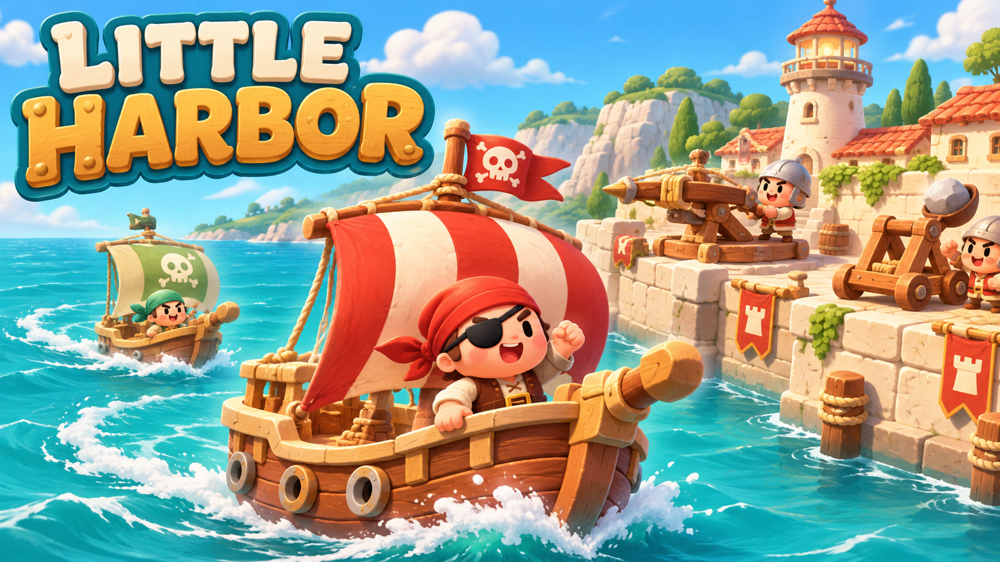

# Little Harbor

A cozy harbor defense game. Merge towers, discover upgrades, and hold off endless pirate fleets.

[Play in your browser](https://eric-schecter.github.io/little-harbor/)

## How to Play

- Build ballistas, catapults, and fire pots; merge matching towers to upgrade.
- Deploy towers on the waterfront to defend your harbor.
- Q/W/E: build · G: stone rain · O: rally · P/Esc: pause.

## Development

Open `project.godot` in Godot 4.7.2. Run `python3 tools/export_web.py` to build the Web version. Pushes to `main` deploy to GitHub Pages.

Runtime code is in `scripts/`, game assets in `assets/`, tests in `tests/`, and build/audio tools in `tools/`.

Art and weapon foley were AI-generated. Music uses CC0 [VSCO Community Edition](https://versilian-studios.com/vsco-community/) samples. Fonts use the SIL Open Font License. [Asset credits](tools/web/THIRD_PARTY.txt).
